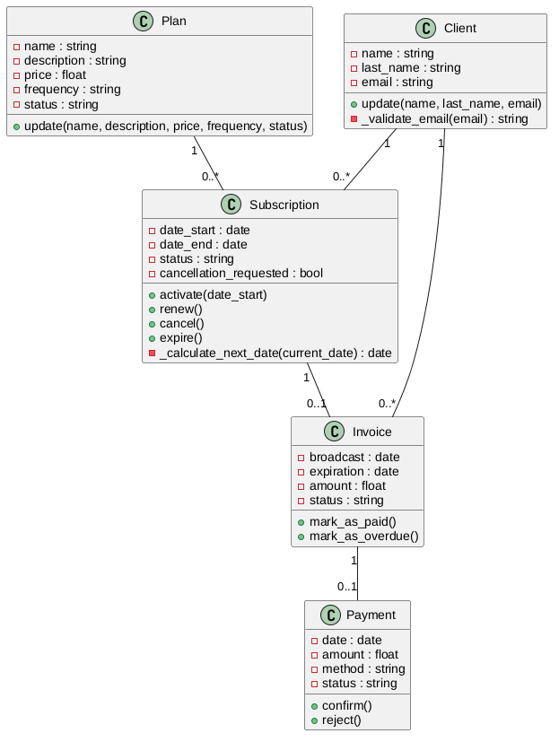

# S&BM — Subscription & Billing Management

Subscription and billing management system (OOP, Python + PostgreSQL).

## Requirements

- Python 3.14+ (managed with `uv`)
- PostgreSQL 14+ (local or remote)
- SQL client (psql, Beekeeper, pgAdmin, etc.)

## Installation

1. Clone the repository.
2. Install dependencies (choose one):
   ```bash
   # pip (Windows/macOS/Linux)
   pip install -r requirements.txt

   # uv (recommended)
   uv pip install -r requirements.txt
   ```
3. Create the database and user with your preferred SQL client
   (psql, Beekeeper, pgAdmin, etc.) and run `database/schema.sql`.
   *(Optional: run `database/seed.sql` to load initial test data).*
4. Configure credentials:
   ```bash
   cp .env.example .env
   # edit .env with host, port, user, password and DB name
   ```

## Usage

```bash
# with uv
uv run python main.py

# or activating the venv
source .venv/bin/activate
python main.py
```

## Architecture (N-layer)

- `models/` — domain entities (Client, Plan, Subscription, Invoice, Payment).
- `services/` — business logic (SubscriptionService).
- `database/` — data access (config, mappers, *_data).
- `utils/` — utilities (dates).

Class diagram:



## Project structure

```
├── main.py
├── models/
├── services/
├── database/
├── utils/
├── tests/
└── docs/
```

## Tests

```bash
# with uv
uv run python -m unittest tests.test_domain tests.test_integration

# or with active venv
python -m unittest tests.test_domain tests.test_integration
```